<div align="center">


# WhatsApp Business Monitor

**See your WhatsApp templates, how they perform and what they cost, on one screen.**<br>
Free and open source. It runs on your computer or your server, and your tokens never leave it.

[](https://github.com/Haythamasalama/whatsapp-business-monitor/actions/workflows/ci.yml)
[](LICENSE)
[](https://github.com/Haythamasalama/whatsapp-business-monitor/pkgs/container/whatsapp-business-monitor)

[🌐 Website](https://wbm.haythamasalama.me/) · [العربية](https://wbm.haythamasalama.me/ar/) · [🚀 Install](#-install) · [📸 Screenshots](#-screenshots) · [🤝 Contribute](CONTRIBUTING.md)

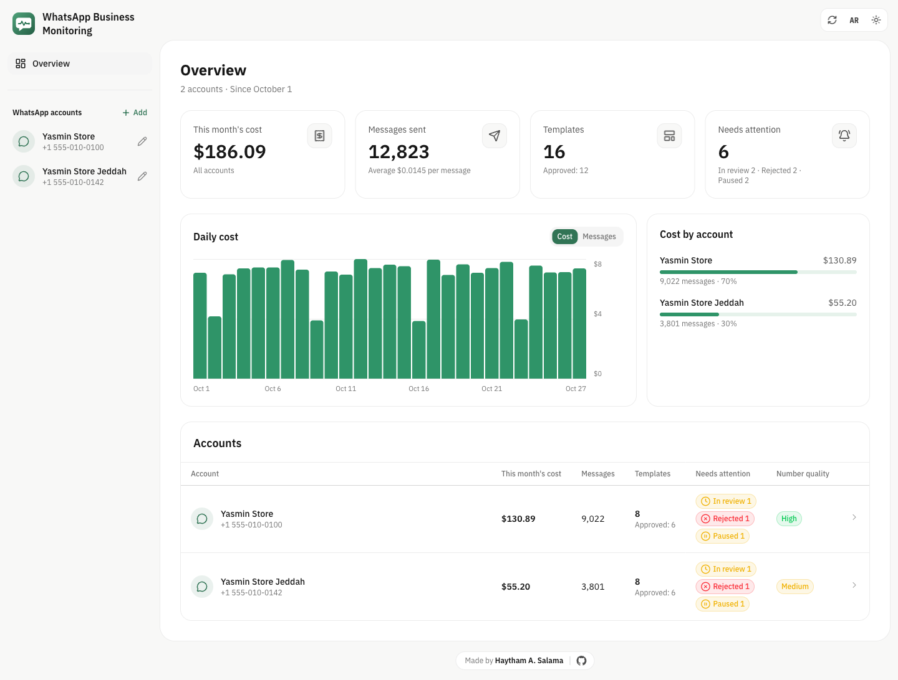

</div>

## ✨ What it does

- 📊 **Every account on one screen:** this month's cost, messages and templates.
- 📝 **Every template's numbers:** status, sends, deliveries and reads for the last 30 days.
- ✏️ **Create and edit templates** with a live WhatsApp preview, or paste a full template as text.
- 🔍 **Find templates fast:** search, filter and sort, as a table, a list with a preview, or cards.
- 🔔 **Alerts** when a template is approved, rejected or paused, with Meta's reason in plain words.
- 📱 **Number health:** whether each number can send now and why not, its quality rating and daily limit.
- ⚙️ **Account settings:** business verification, payment method, people with access and the activity log; for each number its profile and photo, display name, green badge, username, ice breakers and commands, QR codes and short links, and blocked people. [Guide](https://wbm.haythamasalama.me/docs/accounts-and-numbers/)
- 🗂️ **Template housekeeping:** delete a template in one language or all, archive and unarchive, unpause a paused one, copy templates to another account of the same business, act on several at once, and see how many of your 250 or 6,000 templates are used. [Guide](https://wbm.haythamasalama.me/docs/templates/)
- 📊 **Reports and costs:** cost by country, number, category and paid or free, every message sent and received (not only templates), how many of each number's 1,000 free service messages are left this month, volume tier progress, which of two templates gets blocked less, template groups and calls, from 24 hours to 12 months. [Guide](https://wbm.haythamasalama.me/docs/reports-and-costs/)
- 👥 **Several accounts:** find them from a token, and move them all to another computer in one encrypted file.
- 🌍 **Arabic or English,** light or dark.

## 📸 Screenshots

| An account | A template |
|:--:|:--:|
|  |  |
| **List and preview** | **Paste templates as text** |
| 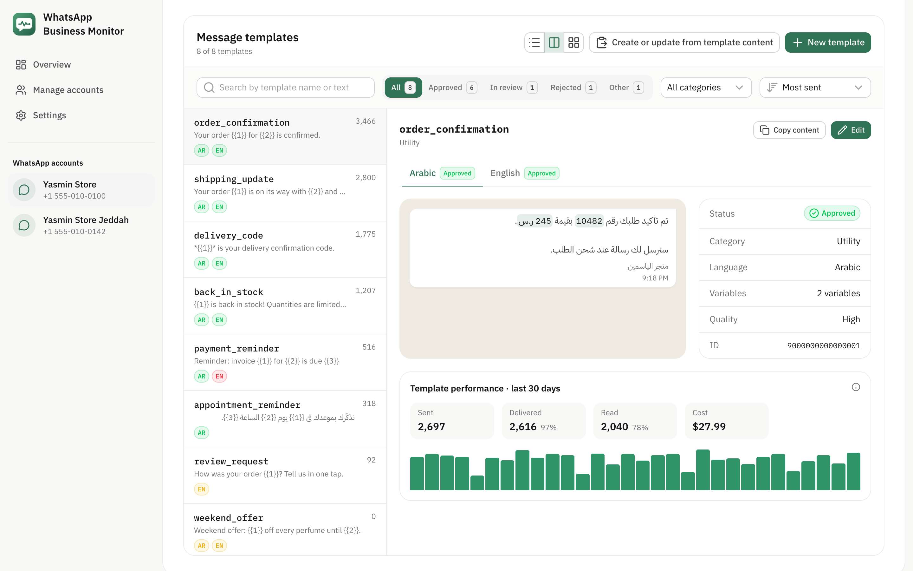 |  |
| **Template housekeeping** | **A paused template** |
| 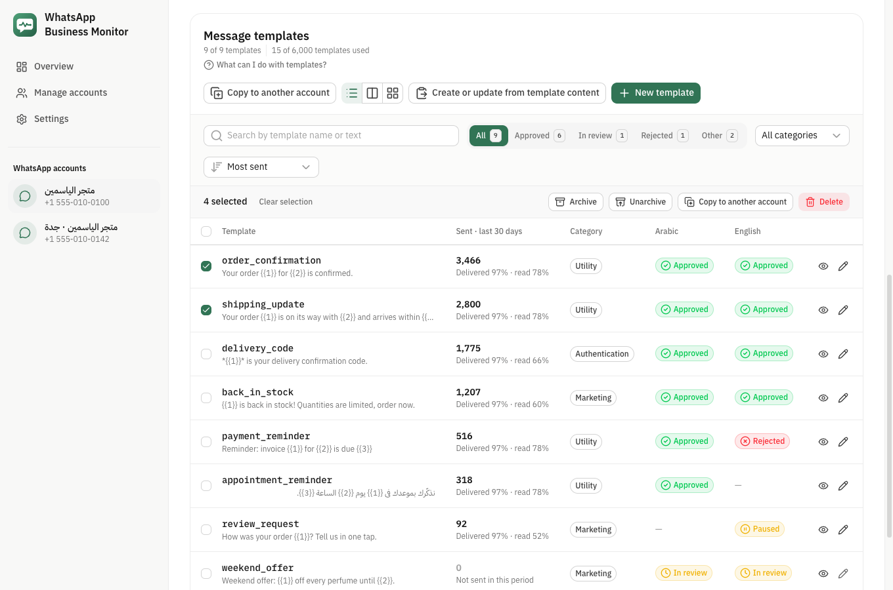 | 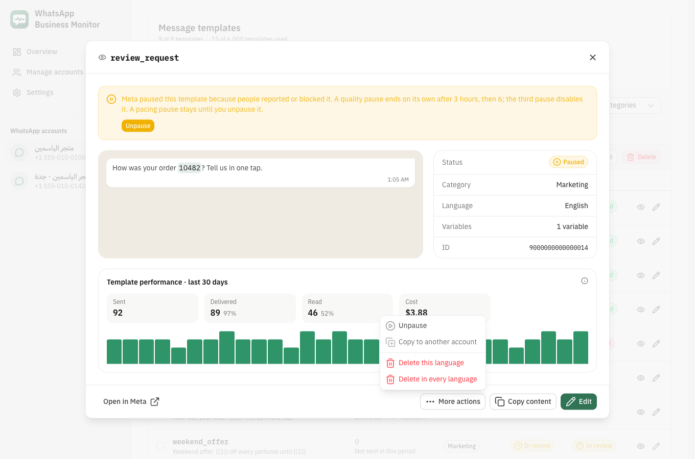 |
| **Account settings** | **A number's QR codes** |
| 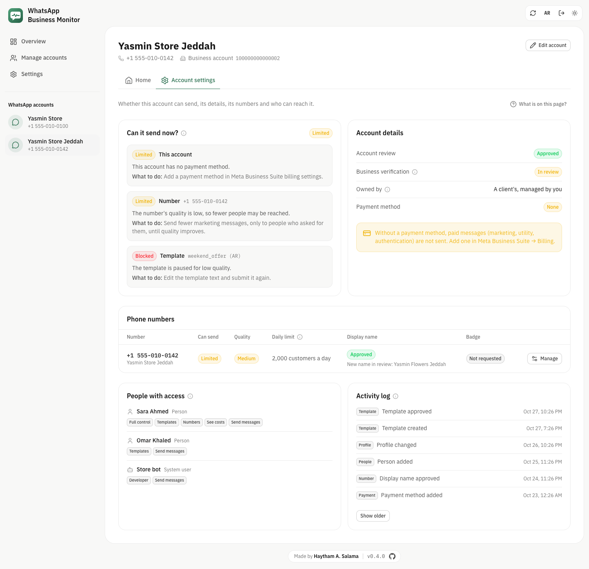 | 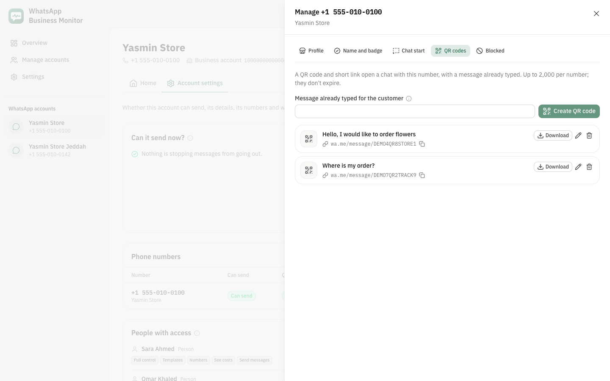 |
| **Reports and costs** | **All messages** |
| 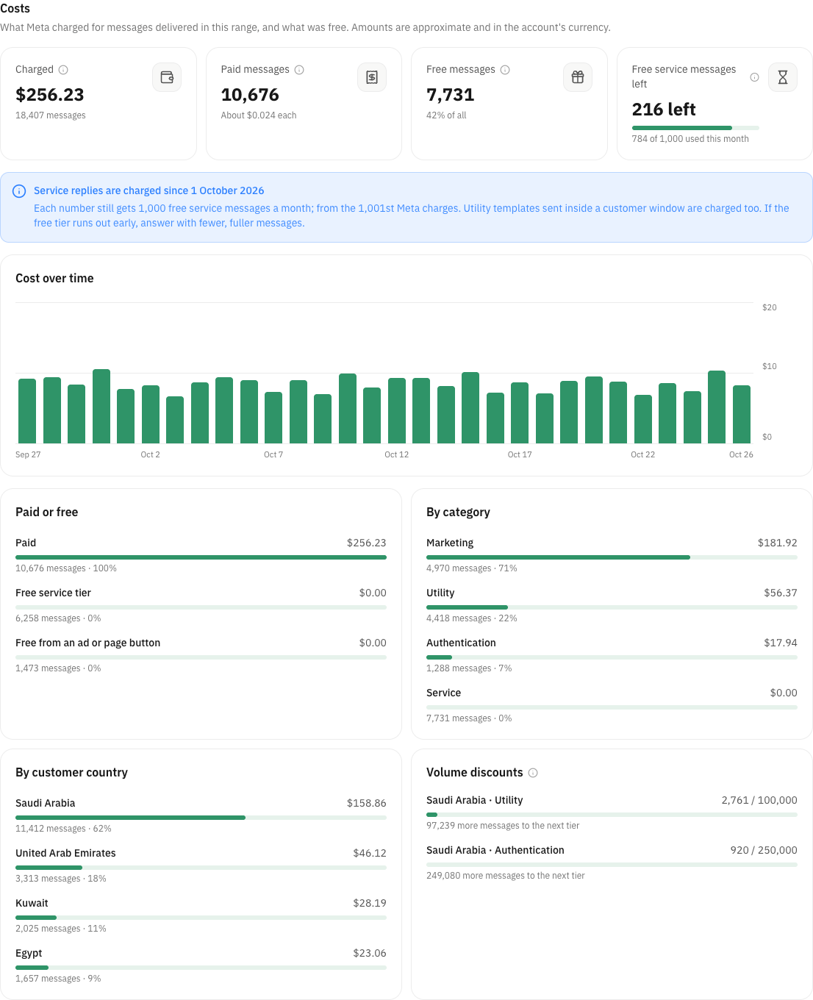 | 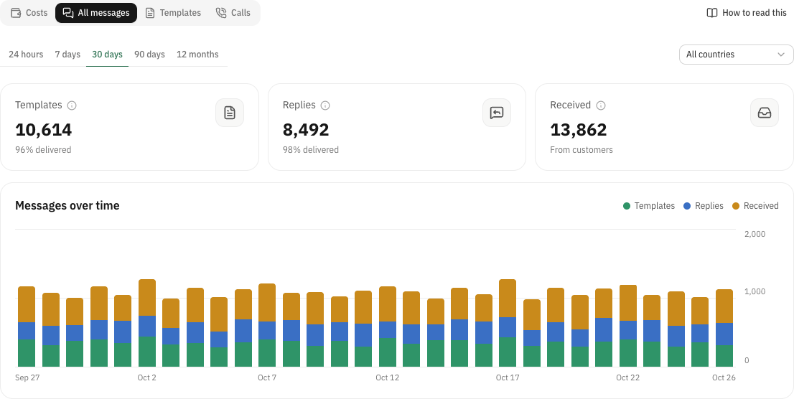 |
| **Accounts** | **Settings** |
| 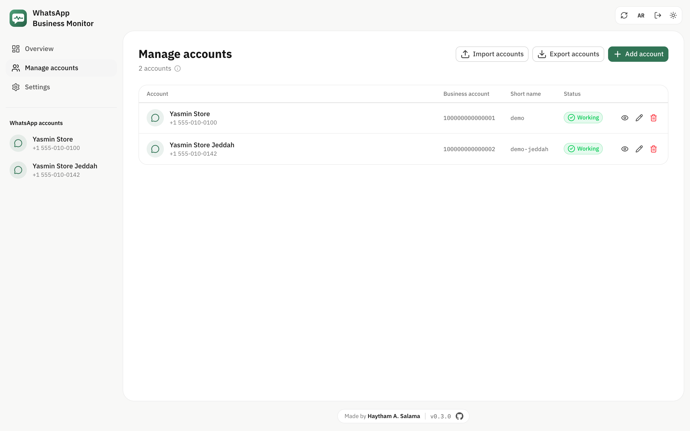 | 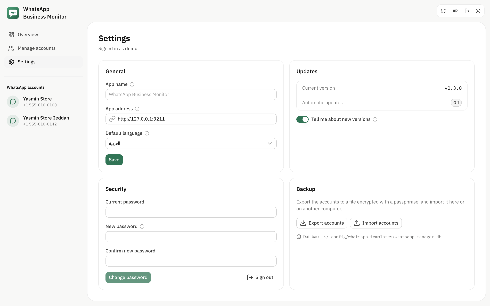 |
| **Dark mode** | **Arabic, right to left** |
|  | 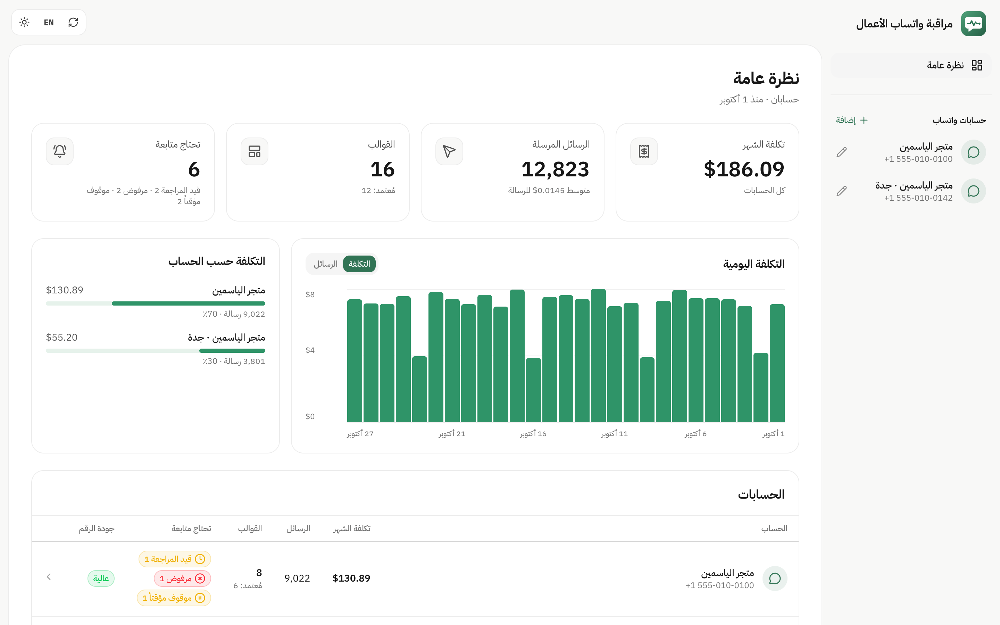 |

The screenshots show a fictional store. More on the [website](https://wbm.haythamasalama.me/#screenshots).

## 🚀 Install

You need [Docker](https://docs.docker.com/get-docker/). Run one command:

```bash
curl -fsSL https://raw.githubusercontent.com/Haythamasalama/whatsapp-business-monitor/main/install.sh | sh
```

Open the address it prints, create your admin account, then add a WhatsApp account with a Meta system user token that has `whatsapp_business_management`.

- **On a server:** add `--server` so other computers can open it: `… | sh -s -- --server`
- **Updates install themselves** every 6 hours, with the same settings and data. To update right away, press **Update now** at the bottom of the app or in Settings. Installs made before v0.7.0 get the button after running the install command once more.
- **Your data** stays in `~/whatsapp-business-monitor`: the settings in `.env`, the database in `data/`.

<details>
<summary>🌐 HTTPS on a server</summary>

Put it behind a reverse proxy (Caddy, nginx, Traefik…) that forwards to port `3210`, and set the same address in **Settings**. With Caddy:

```
wa.example.com {
  reverse_proxy 127.0.0.1:3210
}
```

</details>

<details>
<summary>📌 Stay on one version</summary>

Add `WHATSAPP_MANAGER_VERSION=0.3.0` to `.env` in that folder and run the install command again. Remove the line to follow new releases again.

</details>

<details>
<summary>💻 Run from source</summary>

You need Node.js 22.21+ or 24.11+ and [Bun](https://bun.sh).

```bash
git clone https://github.com/Haythamasalama/whatsapp-business-monitor.git
cd whatsapp-business-monitor
bun install
bun run dev    # http://127.0.0.1:3210
bun run demo   # fictional data, no Meta account needed
```

The database is in `~/.config/whatsapp-templates` (or `WHATSAPP_TEMPLATES_DIR`).

</details>

<details>
<summary>🔐 Security</summary>

- Everything but the setup and sign-in pages needs a sign-in. Passwords are hashed with scrypt; sessions live in an `httpOnly` cookie.
- A new install opened from another computer, through Docker or behind a proxy asks for the **setup code** printed in its log (`docker compose logs`; `install.sh` shows it too), so nobody else can claim it first.
- Ten sign-in tries per address in 15 minutes. Behind your own reverse proxy, set `WHATSAPP_MANAGER_TRUST_PROXY=true` in `.env` so the real visitor's address is counted.
- The app only answers to `localhost`, an IP address, its saved public address, or names in `WHATSAPP_MANAGER_ALLOWED_HOSTS` (comma separated). This stops other sites from reaching it through DNS rebinding.
- Exporting the accounts asks for your sign-in password. Pages can't be framed by other sites.
- No response ever contains an access token. Account exports are encrypted with a passphrase you choose.
- The database folder is private (`700`), the database file `600`.
- Besides Meta, the app only asks GitHub once a day whether a new version is out. You can turn that off in **Settings**.
- Found a vulnerability? See the [security policy](SECURITY.md).

</details>

<details>
<summary>⚠️ Limits from Meta</summary>

- Accounts paid by card have no balance API.
- Template analytics must be turned on once per account, and can't be turned off again.
- Reads and clicks are counted for 7 days after sending.
- An approved template can be edited once every 24 hours, up to 10 times in 30 days.

</details>

## 📄 License

[MIT](LICENSE) · Made by [Haytham A. Salama](https://haythamasalama.me) · Built with [Nuxt](https://nuxt.com) and [Nuxt UI](https://ui.nuxt.com)

WhatsApp is a trademark of Meta Platforms, Inc. This project is not affiliated with or endorsed by Meta.
