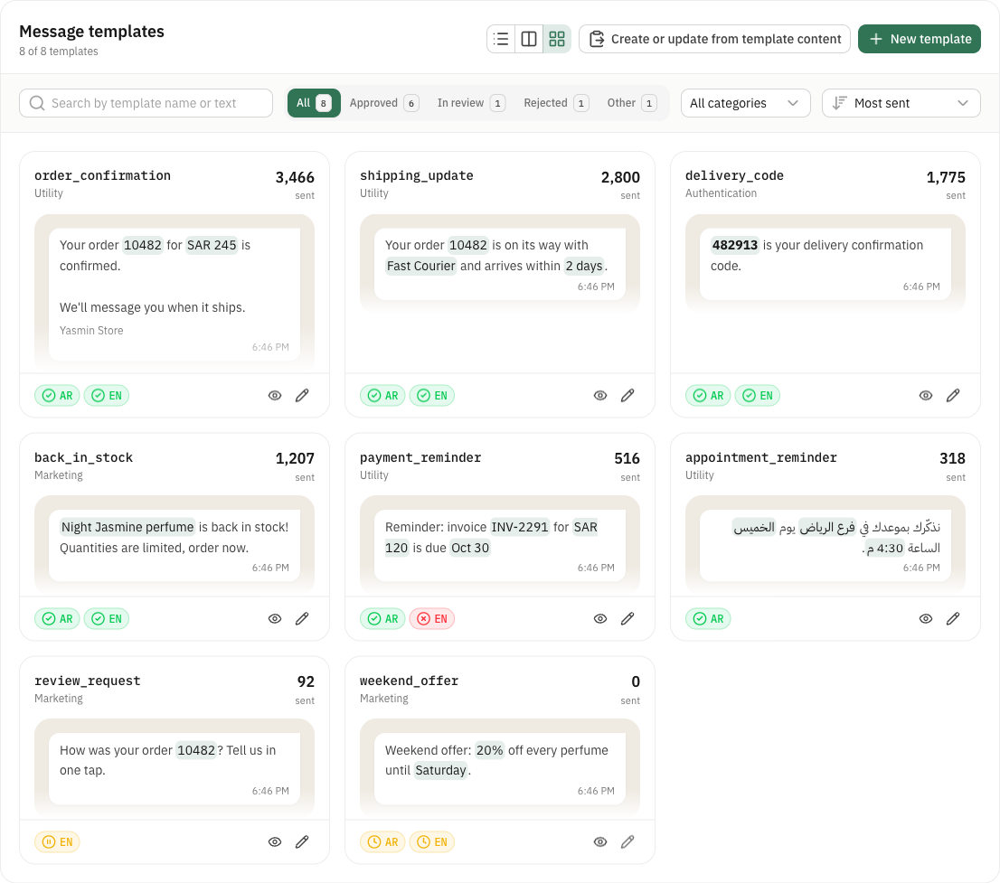

<div align="center">


# WhatsApp Manager Monitoring

**Your WhatsApp templates, how they perform and what they cost, on one screen.**<br>
A free, open-source dashboard for the WhatsApp Business Platform. It runs on your machine; your tokens never leave it.

[](https://github.com/Haythamasalama/whatsapp-manager-monitoring/actions/workflows/ci.yml)
[](LICENSE)


[Features](#-features) · [Install](#-install) · [Updates](#-updates) · [From source](#-run-from-source) · [Contribute](CONTRIBUTING.md)


</div>

## ✨ Features

- 📊 **All accounts in one place.** Cost, messages and templates for every account.
- 📝 **Every template's numbers.** Status, sends, deliveries and reads. Table, list or cards.
- 💰 **What you spend.** This month's cost per day and per message type.
- ✏️ **Create and edit.** Fill in the fields or paste the full template, with a live WhatsApp preview.
- 📋 **Copy and paste.** Copy any template, change it, paste it back. New ones are created, changed ones updated.
- 🔔 **Live status.** A notification when a template is approved, rejected or paused.
- 📱 **Number health.** Status, quality and daily limit of every number.
- 👥 **Manage accounts.** Add, edit and delete accounts in one place, export them all to one file encrypted with your passphrase, and import it on another computer.
- 🌍 **Arabic or English.** Light or dark, and templates in any language.
- 🔒 **Yours.** Runs on your computer or your server, behind your own sign-in, with a setup page on the first visit.

<details>
<summary>The copy and paste format</summary>

```
Name: order_confirmation
Category: Utility
----------------
Language: en
Your order {{1}} is confirmed.

{{1}} = 10482
```

</details>

## 📸 Screenshots

| Account | Template |
|:--:|:--:|
|  |  |
| **Editing** | **Pasted content** |
|  |  |
| **Card view** | **Dark mode** |
|  |  |
| **Arabic, right to left** | |
|  | |

The screenshots show a fictional store.

## 🚀 Install

One command installs it with Docker, on your computer or on a server, and starts it:

```bash
curl -fsSL https://raw.githubusercontent.com/Haythamasalama/whatsapp-manager-monitoring/main/install.sh | sh
```

On a server, so other computers can open it:

```bash
curl -fsSL https://raw.githubusercontent.com/Haythamasalama/whatsapp-manager-monitoring/main/install.sh | sh -s -- --server
```

Then open the address it prints. The first visit shows the setup: the app's name, its address, the language and an admin account. After that, add a WhatsApp account (a Meta system user token with `whatsapp_business_management`) or import the ones you exported elsewhere.

Everything lives in `~/whatsapp-manager`: the settings in `.env`, and the database (accounts, settings, users) in `data/`.

### 🔄 Updates

- **They install themselves.** An updater container ([Watchtower](https://github.com/nicholas-fedor/watchtower)) checks every 6 hours and restarts the app on the new version, with the same settings and data. It only touches this app's containers.
- **Update now:** run the install command again.
- **Stay on a version:** `WHATSAPP_MANAGER_VERSION=0.2.2` in `.env` (or before the install command), then run it again. Remove the line to follow new releases again.

### 🌐 On a server

Put it behind a reverse proxy with HTTPS (Caddy, nginx, Traefik…) that forwards to port `3210`, and set the same address in **Settings**. With Caddy that is two lines:

```
wa.example.com {
  reverse_proxy 127.0.0.1:3210
}
```

## 💻 Run from source

You need Node.js 22.21+ or 24.11+ and [Bun](https://bun.sh) or npm.

```bash
git clone https://github.com/Haythamasalama/whatsapp-manager-monitoring.git
cd whatsapp-manager-monitoring
bun install
bun run dev
```

Then open <http://127.0.0.1:3210>. To update: `git pull && bun install`. The database is in `~/.config/whatsapp-templates` (or `WHATSAPP_TEMPLATES_DIR`).

## 🔐 Security

- Sign-in is required for everything but the setup and the sign-in page. Passwords are hashed with scrypt, sessions are random tokens in an `httpOnly` cookie, and wrong passwords are slowed down.
- No response contains an access token. Exports are encrypted with a passphrase you choose.
- `/api` refuses requests without its `X-Requested-With` header, so a page elsewhere cannot call it with your session.
- The database folder is private (`700`) and the database file `600`.
- Besides Meta, the server only asks GitHub once a day whether a new version is out. Turn it off in **Settings**.
- Found a vulnerability? See the [security policy](SECURITY.md).

## ⚠️ Limits from Meta

- There is no balance API for accounts paid by card.
- Template analytics must be turned on once per account (the app has a button), and can't be turned off.
- Reads and clicks are counted for 7 days after sending.
- An approved template can be edited once every 24 hours, up to 10 times in 30 days.

## 📄 License

[MIT](LICENSE) · Made by [Haytham A. Salama](https://haythamasalama.me) · Built with [Nuxt](https://nuxt.com) and [Nuxt UI](https://ui.nuxt.com).

WhatsApp is a trademark of Meta Platforms, Inc. This project is not affiliated with or endorsed by Meta.
