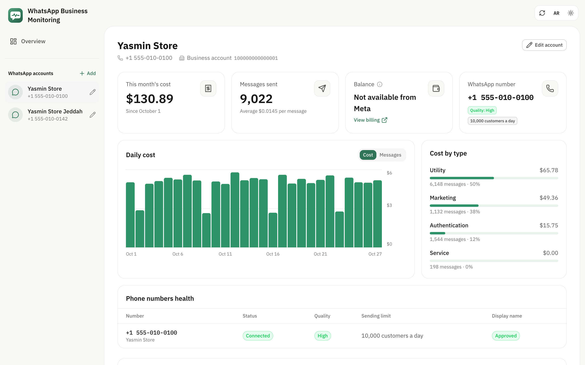
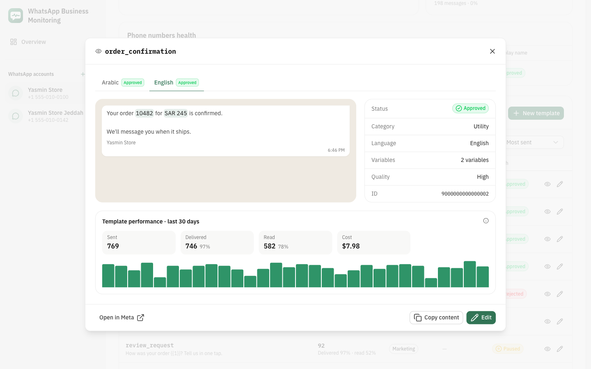
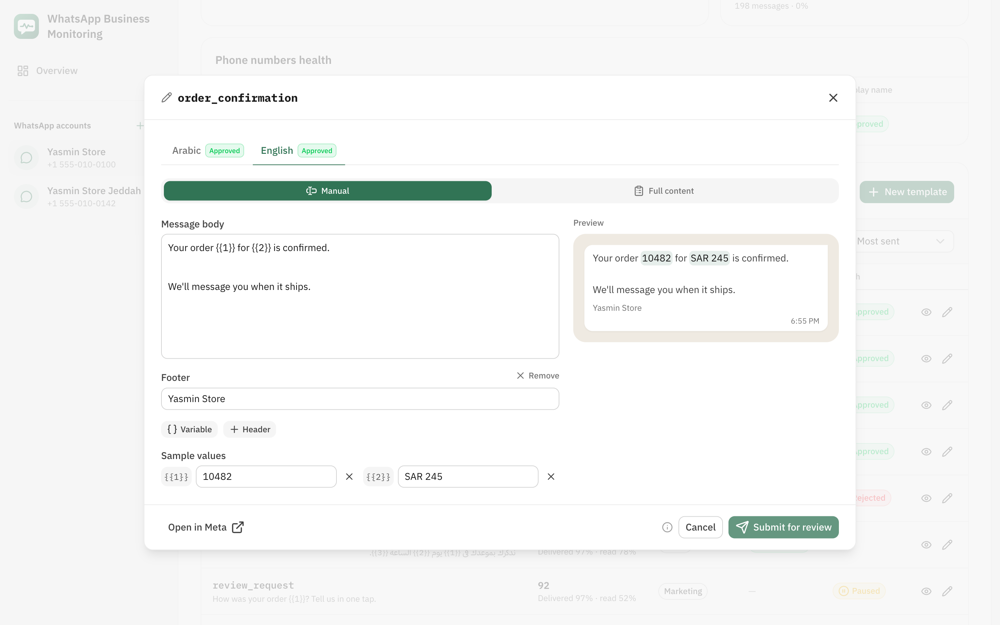
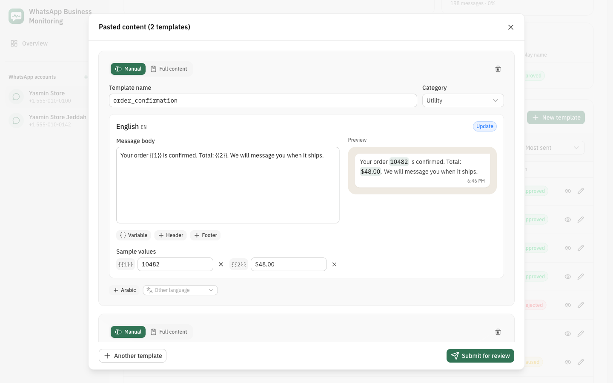
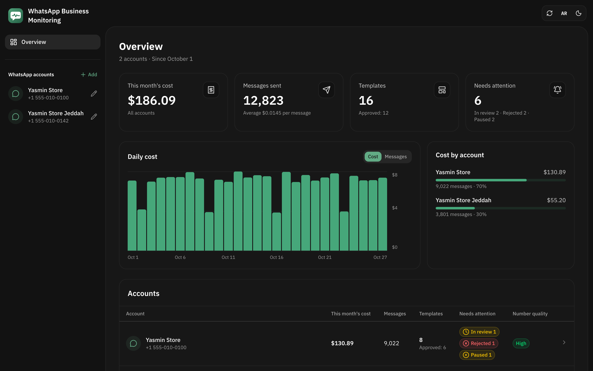

<div align="center">


# WhatsApp Manager Monitoring

**Every WhatsApp template, how it performs and what it costs, on one screen.**<br>
A free, open-source dashboard for the WhatsApp Business Platform. It runs on your machine, and your access tokens never leave it.

[](https://github.com/Haythamasalama/whatsapp-manager-monitoring/actions/workflows/ci.yml)
[](LICENSE)


[Features](#features) · [Get started](#get-started) · [Try the demo](#try-it-with-demo-data) · [Contribute](CONTRIBUTING.md)



</div>

## Features

- **Templates at a glance.** Every template on the account, grouped by name, with a column per language for its review status, plus its category and quality.
- **Three views.** A table, a list with the selected template beside it, or cards with a preview of each message. The page remembers your choice.
- **How each template performs.** Sent, delivered, read, cost and button clicks over the last 30 days, with a daily chart, from Meta's template analytics. Sort by the most sent.
- **What you spend.** This month's cost and message count, per day and per message type (marketing, utility, authentication, service).
- **Preview like the customer.** The message rendered as a WhatsApp bubble, with the sample values filled in, line by line in the right direction for Arabic and English.
- **Create and edit, two ways.** *Manual*: header, body, footer, and a sample value per `{{n}}`, with buttons to add or remove a variable (the rest are renumbered), a header or a footer. *Template code*: the whole template as plain labelled text with a live preview. Meta's rules are checked before anything is sent; buttons and media headers are kept as they are when you edit.
- **Copy any template.** One click copies it as text, with every language and sample value, ready to change and paste back as a new one:

  ```
  الاسم: order_confirmation
  الفئة: إشعارات
  ----------------
  اللغة: ar
  تم تأكيد طلبك رقم {{1}}.

  {{1}} = 10482
  ```
- **Create or update from text.** Paste one or several templates in that format. A template that doesn't exist yet is created; one that does is updated with the new text, keeping its category and sample values. Unchanged or locked templates (under review, for example) are skipped.
- **Any language.** Arabic and English first, plus any language Meta supports.
- **Always current.** Data refreshes when you come back to the tab, and every minute while a template waits for review. A notification tells you when a template is approved, rejected or paused, including what changed since your last visit.
- **Several accounts.** Add, edit and switch between WhatsApp Business Accounts, each shown with its WhatsApp profile photo. Paste a token and it finds the accounts and phone numbers it can reach.
- **Private.** No account, no cloud, no tracking. The server only listens on your machine.

The interface is in Arabic, right to left, in light and dark mode.

## Screenshots

| Template preview and numbers | Editing a template |
|:--:|:--:|
|  |  |
| **Create or update from pasted text** | **Dark mode** |
|  |  |

Every screenshot uses the built-in demo data: a fictional store with made-up numbers.

## Get started

You need Node.js 22.21+ or 24.11+ (see `.nvmrc`) and [Bun](https://bun.sh) or npm.

```bash
git clone https://github.com/Haythamasalama/whatsapp-manager-monitoring.git
cd whatsapp-manager-monitoring
bun install
bun run dev
```

Open <http://127.0.0.1:3210> and choose **إضافة حساب** (add account). You need:

- a Meta **system user access token** with the `whatsapp_business_management` permission;
- the **WhatsApp Business Account ID** (WABA ID). Paste the token and the app finds it for you.

## Try it with demo data

No Meta account needed:

```bash
bun run demo
```

Then open <http://127.0.0.1:3211>. Nothing is sent to Meta and no file is written.

## Where accounts are stored

Each account is one file in `~/.config/whatsapp-templates/`. Set `WHATSAPP_TEMPLATES_DIR` in `.env` to use another folder (see `.env.example`). The app writes these files itself, with `600` permissions, after checking the token against Meta:

```bash
# ~/.config/whatsapp-templates/main.env
WHATSAPP_LABEL='My store'
WHATSAPP_TOKEN=...
WHATSAPP_WABA_ID=...
WHATSAPP_VERSION=v23.0
```

Keep that folder outside the project. `.gitignore` also ignores `*.env` and `accounts/` in case one ends up here.

## Security

- The server listens on `127.0.0.1` only, and tokens stay in it: no API response contains one.
- `/api` refuses any `Host` other than `127.0.0.1` or `localhost`, and any request without the `X-Requested-With: whatsapp-manager` header. Another site open in your browser cannot call it, because that header forces a CORS preflight the server never answers.
- There is no login, so do not deploy it to a public server as it is.

Found a vulnerability? Please see the [security policy](SECURITY.md).

## Limits that come from Meta

- **Balance.** Meta has no API for the balance of an account paid by card. A credit line's balance shows only when the token also has `business_management`.
- **Template analytics** must be confirmed once per account, in WhatsApp Manager or with the app's **تفعيل الإحصاءات** button. Meta cannot turn it off again.
- Reads and button clicks are counted for 7 days after a message is sent.
- An approved template can be edited once every 24 hours, up to 10 times in 30 days. Its name and language never change.

## Built with

[Nuxt 4](https://nuxt.com), [Nuxt UI 4](https://ui.nuxt.com), Tailwind CSS 4 and the [WhatsApp Cloud API](https://developers.facebook.com/documentation/business-messaging/whatsapp).

## Contributing

Bug reports, ideas and pull requests are welcome. Start with the [contributing guide](CONTRIBUTING.md), and please follow the [Code of Conduct](CODE_OF_CONDUCT.md).

## License

[MIT](LICENSE) · Made by [Haytham A. Salama](https://haythamasalama.me)

WhatsApp is a trademark of Meta Platforms, Inc. This project is not affiliated with, endorsed or sponsored by Meta or WhatsApp.

---

<div dir="rtl">

## بالعربية

**مراقبة واتساب للأعمال**: لوحة مجانية ومفتوحة المصدر لمراقبة قوالب رسائل واتساب لحساب أو أكثر. تعرض حالة مراجعة كل قالب، وعدد مرات إرساله، ونسب التسليم والقراءة، وتكلفة الشهر، وتتيح إنشاء القوالب وتعديلها وإنشاءها من نص ملصوق.

تعمل على جهازك فقط: تُحفظ رموز الوصول في ملفات داخل `~/.config/whatsapp-templates/`، ولا تصل إلى المتصفح.

```bash
bun install
bun run dev    # حساباتك الحقيقية
bun run demo   # بيانات تجريبية لمتجر وهمي
```

</div>
